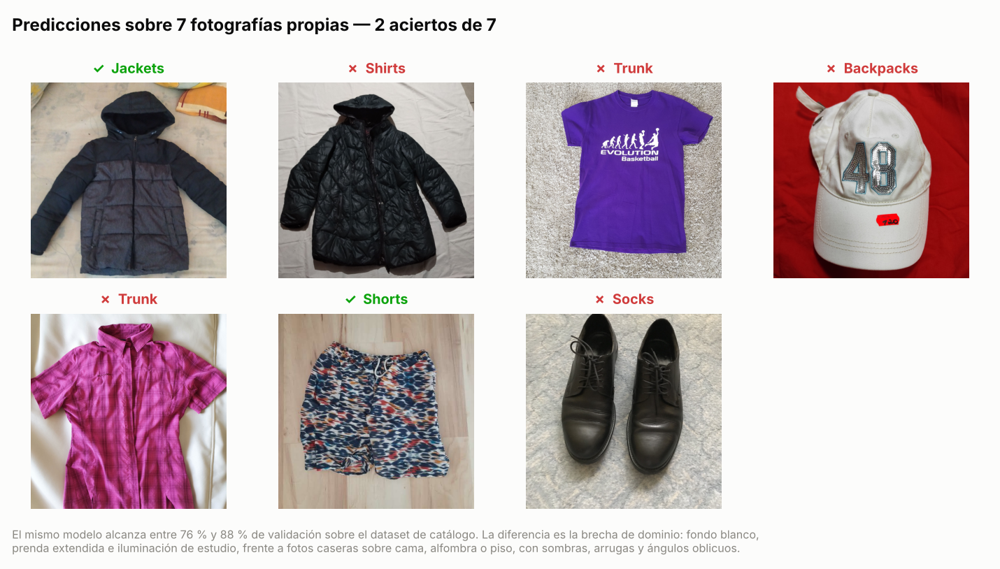

# Clasificador de prendas de vestir con VGG16

Clasificación de imágenes de ropa en 143 categorías usando transfer learning sobre
VGG16, en tres etapas: una primera versión que falló, el diagnóstico del error, y
una versión corregida probada sobre fotografías propias.



## Problema

El objetivo era entrenar un clasificador capaz de identificar el tipo de prenda a
partir de una fotografía. El conjunto de datos disponible son imágenes de catálogo
—fondo blanco, prenda centrada, iluminación de estudio—, pero el uso real de un
modelo así sería sobre fotos tomadas por una persona cualquiera, en condiciones muy
distintas.

Esa diferencia entre los datos de entrenamiento y los datos reales resultó ser el
hallazgo principal del proyecto.

## Datos

- **Fuente:** [Fashion Product Images Dataset](https://www.kaggle.com/datasets/paramaggarwal/fashion-product-images-dataset) (Kaggle)
- **Volumen:** 44.446 imágenes
- **Clases:** 143 categorías de producto (Shirts, Jeans, Watches, Sandals, Kurtas…)
- **Distribución:** fuertemente desbalanceada — unas pocas categorías concentran la
  mayoría de las imágenes y muchas tienen apenas unas decenas
- **Prueba adicional:** 7 fotografías propias de prendas, tomadas en casa con
  teléfono, incluidas en `imagenes/`

## Versión 1 — el intento que falló

**Arquitectura:** VGG16 preentrenada en ImageNet con `include_top=False` y la base
**congelada**, seguida de `Flatten → Dense(256, relu) → Dropout(0.5) → Dense(143, softmax)`.
Optimizador Adam con sus parámetros por defecto, 10 épocas.

**Resultado:**

| | valor |
|---|---:|
| accuracy (entrenamiento) | 0,2427 |
| val_accuracy | 0,1613 |
| loss | 69,47 |

Probado sobre tres imágenes de prueba, acertó **cero**: una camisa la clasificó como
Kurtas, unos jeans como Shirts y un reloj como Shirts.

**Por qué falló.** Dos errores que se refuerzan:

El primero es la **tasa de aprendizaje**. Adam usa por defecto `learning_rate=1e-3`,
que es apropiado para una red inicializada al azar pero demasiado grande para capas
preentrenadas: las primeras actualizaciones destruyen los pesos que ImageNet había
aprendido. La pérdida de 69,47 es la señal — para 143 clases, una predicción
completamente aleatoria da ln(143) ≈ 4,96, así que 69 no es "aprendió poco", es un
modelo cuyos pesos salieron disparados.

El segundo es que con la base **congelada** el modelo solo podía ajustar las dos
capas densas finales. Las características que VGG16 extrae de ImageNet sirven para
distinguir perros de automóviles, pero no para separar una camisa de una kurta, que
se diferencian en detalles finos de corte y textura.

## Versión 2 — la corrección

**Qué cambió:**

- Se **descongeló toda la base VGG16** (`layer.trainable = True`), pasando de
  entrenar ~130 mil parámetros a entrenar **27.728.078**
- Se bajó la tasa de aprendizaje a **`Adam(learning_rate=1e-5)`**, dos órdenes de
  magnitud por debajo del valor por defecto
- Se agregó **regularización L2** (`kernel_regularizer=regularizers.l2(0.01)`) en la
  capa densa intermedia
- Se amplió la cabeza a `Dense(512) → Dropout → Dense(256, L2) → Dropout → Dense(142, softmax)`
- 20 épocas en lugar de 10

**Resultado:**

| época | accuracy | val_accuracy |
|---|---:|---:|
| 1 | 0,2512 | 0,6135 |
| 18 | 0,8750 | **0,8800** |
| 19 | 0,7881 | 0,8151 |
| 20 | 0,8438 | 0,7600 |

**Validación entre 76 % y 88 % sobre 143 clases**, frente a un azar de 0,7 %.

No hay sobreajuste: la validación va pegada al entrenamiento y en la época 18 incluso
por encima, lo que es normal cuando el dropout actúa durante el entrenamiento y no
durante la validación.

El salto de 0,1613 a 0,88 vino de dos cambios de una línea cada uno. El trabajo no
estuvo en escribir más código sino en entender por qué el primero no funcionaba.

Tiempo de entrenamiento: 4 h 47 min en GPU T4 x2.

## La prueba que importa

Con el modelo de la versión 2 clasifiqué **7 fotografías propias** de prendas sobre
una cama. Acertó **2 de 7**:

| prenda | predicción | |
|---|---|:-:|
| Chaqueta acolchada negra | Jackets | ✅ |
| Pantaloneta estampada | Shorts | ✅ |
| Abrigo acolchado | Shirts | ❌ |
| Camiseta morada | Trunk | ❌ |
| Gorra blanca | Backpacks | ❌ |
| Blusa fucsia estampada | Trunk | ❌ |
| Zapatos negros de cuero | Socks | ❌ |

**29 % contra el 80 % de validación.** Y esa distancia es el resultado más útil del
proyecto.

El modelo no está roto: funciona bien sobre el tipo de imagen con el que fue
entrenado. Lo que no sabe hacer es generalizar a otro dominio. Las imágenes del
dataset son fotos de catálogo con fondo blanco uniforme, la prenda extendida y sin
sombras; las mías están tomadas en casa sobre una cama, una alfombra o el piso, con
arrugas, sombras y ángulos oblicuos.
Son objetos iguales en situaciones visuales distintas.

Esto se llama **brecha de dominio** (*domain shift*), y es la razón por la que un
número de validación alto no garantiza que un modelo sirva en producción. Si solo
hubiera reportado el 88 % de la época 18, el proyecto parecería un éxito.

## Limitaciones

- **Desbalance de clases no corregido.** No se aplicó ponderación ni remuestreo, y no
  se calcularon métricas por clase, así que no sé qué categorías el modelo resuelve
  bien y cuáles no detecta nunca. La exactitud global puede estar sostenida por las
  categorías mayoritarias.
- **Desajuste en el diccionario de etiquetas.** El modelo de la versión 2 termina en
  `Dense(142)` mientras que el diccionario `class_labels` tiene 143 entradas. Hay una
  clase de diferencia que quedó sin conciliar entre las dos versiones, de modo que las
  etiquetas por encima de cierto índice no son confiables.
- **Muestra de prueba muy pequeña.** Siete fotografías no permiten estimar el
  desempeño real fuera del dataset; sirven para detectar el problema, no para
  cuantificarlo.
- **Sin conjunto de prueba independiente.** La evaluación se hizo sobre el generador
  de validación, que se usó durante el entrenamiento para monitorear. Los números
  reportados son optimistas.

## Qué haría distinto

- Separar un conjunto de prueba que no se toque durante el entrenamiento.
- Calcular matriz de confusión y métricas por clase, no solo exactitud global.
- Aplicar aumento de datos que acerque el entrenamiento al dominio real: fondos
  variados, rotaciones, cambios de iluminación, desenfoque.
- Construir un conjunto de prueba de fotografías reales de tamaño suficiente para
  medir la brecha, en vez de solo constatarla.
- Tratar el desbalance desde el diseño, con ponderación de clases.

## Stack

Python · TensorFlow / Keras · VGG16 · NumPy · Matplotlib

## Estructura

```
├── notebooks/
│   ├── 01_clasificador_v1.ipynb      # primera versión, base congelada
│   ├── 02_clasificador_v2.ipynb      # versión corregida, base descongelada
│   └── 03_prueba_fotos_reales.ipynb  # inferencia sobre fotografías propias
├── imagenes/                          # las 7 fotografías de prueba
└── README.md
```

Los modelos entrenados (`.h5`, ~105 MB cada uno) no están en el repositorio por el
límite de tamaño de GitHub. Están publicados como Kaggle Models:

- [moda](https://www.kaggle.com/models/yeisongmezmeja/moda) — versión 1
- [moda2](https://www.kaggle.com/models/yeisongmezmeja/moda2) — versión 2

## Ejecución original

Los tres notebooks se ejecutaron en Kaggle y allí están sus corridas completas, con
los registros de entrenamiento y las salidas:

- [Clasificador](https://www.kaggle.com/code/yeisongmezmeja/clasificador) — versión 1
- [clasificador2.0](https://www.kaggle.com/code/yeisongmezmeja/clasificador2-0) — versión 2
- [Clasificacion_2](https://www.kaggle.com/code/yeisongmezmeja/clasificacion-2) — prueba sobre fotos reales

---

*Proyecto desarrollado en 2024 como ejercicio de transfer learning y visión por
computador.*
